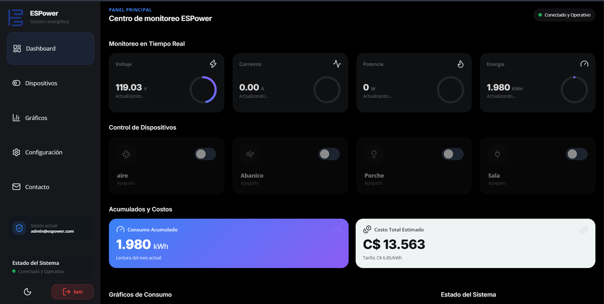
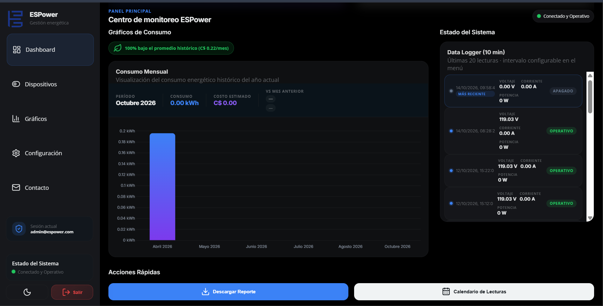
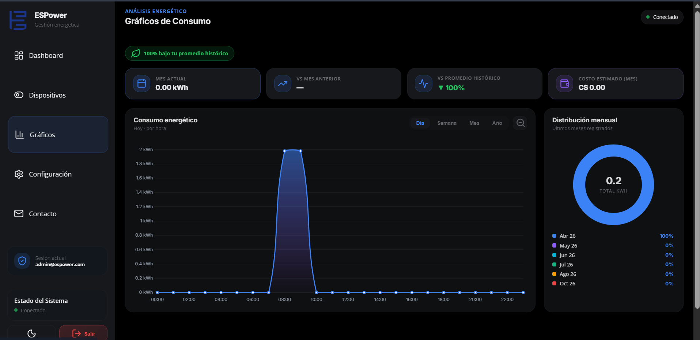
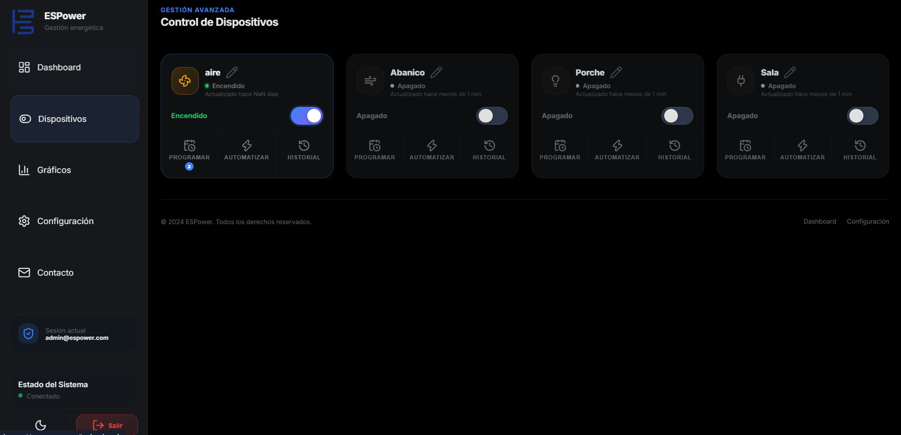

# ESPower — monitoreo energético con ESP32 y Firebase

ESPower reúne un medidor basado en **ESP32**, sensores de voltaje **ZMPT101B** y corriente **SCT-013**, una pantalla OLED y una aplicación web que consulta y controla datos en **Firebase Authentication + Realtime Database**. El firmware mide voltaje, corriente, potencia y energía acumulada; la web muestra la telemetría, registros, gráficos, costos y estados de dispositivos.

Este repositorio contiene la aplicación web estática, el firmware Arduino y los esquemas y fotografías facilitados para documentar el montaje. La configuración privada se completa localmente y se excluye de Git.

## Recorrido del sistema

### 1. Montaje y componentes

La fotografía muestra la etapa de trabajo con placas ESP32, pantalla y módulos de prueba. Sirve para identificar los bloques físicos antes de seguir las conexiones del esquema; no sustituye al esquema eléctrico ni fija los valores de cada componente.

### 2. Esquema completo

El plano separa alimentación de 5 V a 3,3 V, lectura de tensión con ZMPT101B, lectura de corriente con SCT-013, OLED por I²C y etapa de salida con optotriac y triac. La [guía del circuito](docs/CIRCUITO.md) relaciona cada bloque con los pines del firmware y señala las diferencias que se deben verificar en la placa montada.

.png>)

### 3. Adaptación del transformador de corriente

La señal alterna del CT confirmado de **100 A:50 mA** se convierte a voltaje con la resistencia de carga **montada de 33 Ω** y se desplaza hacia un punto medio de 1,65 V para el ADC del ESP32. El firmware usa ahora `CONSTANTE_I = 60.6`, su calibración teórica. **A 100 A la señal calculada supera 0–3,3 V** y se recorta; la [guía de cálculo y calibración](docs/CIRCUITO.md#resistencia-de-carga-del-ct) cuantifica el rango útil y explica cómo redimensionar la carga si se necesita medir hasta 100 A.

### 4. Telemetría y panel principal

El ESP32 publica `voltaje`, `corriente`, `potencia` y `kwh` bajo `UsersData/{uid}/telemetry`. La web escucha esas rutas después de iniciar sesión y actualiza las tarjetas de lectura y la estimación de costo. [Conexión con Firebase](docs/FIREBASE.md) describe las cuentas, rutas, reglas y archivos locales de configuración.

### 5. Registro histórico

El firmware escribe registros con fecha y hora obtenidas por NTP en `UsersData/{uid}/datalog/YYYY-MM-DD/HH-MM`. La web consulta registros recientes y también puede registrar muestras mientras permanece abierta. El intervalo de ambos procesos se configura por separado; consulta [flujo de datos](docs/ARQUITECTURA.md#registro-y-consumo-mensual).

### 6. Análisis

La página de gráficos usa los datos mensuales de RTDB y el historial para mostrar consumo y costo estimado. El costo se calcula con una tarifa en **C$/kWh** configurable por cuenta; no es una factura emitida por la distribuidora.

### 7. Control de dispositivos

La web permite cambiar estados en `led`, `led1`, `led2` y `led3`, asignar nombres y definir horarios o reglas. El firmware incluido **lee `led`, controla la salida del optotriac en GPIO0 y refleja el estado en GPIO2**. Las otras tres salidas no tienen rutina de accionamiento en este sketch. GPIO0 participa en el arranque del ESP32; el [manual del firmware](docs/FIRMWARE.md#arranque-y-rutas) explica qué se debe comprobar en el hardware. La [matriz de funciones](docs/ARQUITECTURA.md#alcance-comprobado-en-el-código) muestra el alcance de cada parte.

## Puesta en marcha

1. Revisa el [circuito y la calibración](docs/CIRCUITO.md): el CT es 100 A:50 mA, la carga montada es 33 Ω y la salida usa GPIO0. Comprueba el rango del ZMPT101B, el límite de corriente sin recorte y el comportamiento de GPIO0 durante el arranque.
2. Crea o selecciona un proyecto Firebase con Authentication (correo/contraseña) y Realtime Database. Sigue [FIREBASE.md](docs/FIREBASE.md), incluida la revisión de reglas por UID.
3. Copia `js/firebase-config.example.js` a `js/firebase-config.local.js` y completa los datos de la aplicación web. Ese archivo queda excluido de Git.
4. Copia `Firmware/Espower/config.local.example.h` a `Firmware/Espower/config.local.h` y completa los datos de la cuenta del dispositivo. Usa una cuenta dedicada y nunca publiques su contraseña.
5. Instala las bibliotecas Arduino indicadas en [FIRMWARE.md](docs/FIRMWARE.md), abre `Firmware/Espower/Espower.ino`, selecciona tu ESP32 y compila. Carga el sketch sólo después de verificar las conexiones de baja tensión y el acondicionamiento de las entradas ADC.
6. Sirve la carpeta raíz por HTTP/HTTPS para abrir `index.html` y las páginas de `html/`. Los módulos JavaScript no deben abrirse con `file://`. Para desplegar, publica también tu archivo local de configuración web en el hosting elegido, **fuera de Git**.
7. Inicia sesión con la cuenta Firebase correspondiente al UID usado por el firmware. Comprueba que aparecen lecturas en RTDB y en la web.

La aplicación web no requiere npm ni proceso de compilación: carga módulos ES y bibliotecas desde CDN. Requiere conexión a internet para Firebase y esas bibliotecas. Los detalles de operación, frecuencia de escrituras, restauración de energía y límites actuales están en [FIRMWARE.md](docs/FIRMWARE.md) y [ARQUITECTURA.md](docs/ARQUITECTURA.md).

## Estructura

| Ruta | Contenido |
| --- | --- |
| `Firmware/Espower/` | Sketch ESP32 y plantilla de configuración local |
| `js/` | Autenticación, rutas RTDB, panel, gráficos, dispositivos y configuración |
| `html/`, `index.html`, `404.html` | Vistas web estáticas |
| `css/`, `assets/` | Estilos e identidad visual |
| `images/` | Capturas, fotografía y esquemas usados en esta documentación |
| `docs/` | Circuito, Firebase, firmware y arquitectura |

## Archivos privados

`js/firebase-config.local.js` y `Firmware/Espower/config.local.h` se necesitan para una instalación concreta, pero **no se suben al repositorio**. Tampoco se publican contraseñas Wi-Fi, archivos de servicio, tokens o claves privadas. Las plantillas contienen campos vacíos. La configuración web de Firebase es visible para el navegador durante la ejecución; la protección real de los datos depende de Authentication y de las reglas de Realtime Database.
