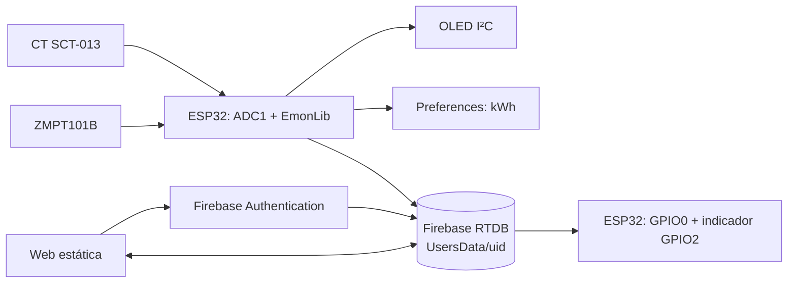

# Arquitectura, datos y alcance

ESPower consta de un **ESP32 medidor**, Firebase Authentication + Realtime Database y una **aplicación web estática**. El ESP32 produce las mediciones; Firebase conserva los datos y estados; las páginas web muestran información y escriben ajustes o comandos. La configuración concreta de Firebase queda fuera del repositorio.



## Páginas y módulos

| Página | Módulo | Función |
| --- | --- | --- |
| `index.html` | `js/app.js` | Sesión, lecturas, datalog, costo, estados y gráfico |
| `html/charts.html` | `js/charts.js` | Historial y gráficos de consumo mensual |
| `html/devices.html` | `js/devices.js` | Estados, nombres, horarios y automatizaciones |
| `html/config.html` | `js/config.js` | Preferencias, orden de reinicio y borrado de datos del usuario |
| `html/contact.html` | `js/contact.js` | Vista de contacto |
| Páginas de aplicación | `js/background.js`, `js/firebase-paths.js` | Evaluación de reglas en navegador y rutas RTDB |

La web usa módulos JavaScript nativos y SDK Firebase 10.12.5 desde CDN. `css/styles.css`, `assets/` y los scripts de tema/barra lateral completan las vistas. No hay build ni backend web en este repositorio; los módulos requieren un servidor estático HTTP/HTTPS.

## Flujo de medición y costo

El firmware realiza `calcVI`, obtiene `Vrms`, `Irms`, potencia real/aparente y factor de potencia, y suma kWh. Cada 3 s nominales envía cuatro campos numéricos a `UsersData/{uid}/telemetry`. Las páginas escuchan RTDB con `onValue`. La energía acumulada reside primero en el ESP32 y se guarda en NVS cada 30 s; RTDB recibe la lectura publicada. Los cálculos se detallan en [FIRMWARE.md](FIRMWARE.md#medición-y-fórmulas).

El costo mostrado es una **estimación**: `consumo (kWh) × tarifa (C$/kWh)`. La tarifa se guarda bajo `configure/tarifa` y en `localStorage` del navegador. No se implementan tramos, cargos fijos ni impuestos de una factura.

## Registro y consumo mensual

El firmware escribe un objeto por minuto nominal en `datalog/YYYY-MM-DD/HH-MM`, con fecha configurada a UTC−6 y `timestamp` Unix. Con el dashboard abierto, `js/app.js` también escribe en **esa misma ruta**, según `configure/dataloggerMinutes` (15 min por defecto en el navegador). El objeto web contiene `datetime`; el del firmware contiene `fp` y `timestamp`. Si ambos escriben en el mismo minuto, `set()` reemplaza el objeto anterior: no todos los campos de un registro proceden necesariamente del dispositivo.

Para cada mes `YYYY-MM`, la web lee `telemetry/kwh`. Si no hay `monthStart/YYYY-MM`, guarda como base **el primer valor observado ese mes**; no necesariamente el de las 00:00 del día 1. Después calcula:

```text
monthly/YYYY-MM = max(0, telemetry/kwh − monthStart/YYYY-MM)
costo mensual estimado = monthly/YYYY-MM × configure/tarifa
```

`monthly/` sólo se actualiza cuando el dashboard está abierto y autenticado. Si no se abre durante un mes, no se crea automáticamente su resumen ni se reconstruye desde el historial. Si el contador del dispositivo cae por debajo de la base mensual tras un reinicio o cambio de placa, el cálculo muestra cero hasta alcanzarla. La captura de [gráficos](../images/ESP-3.png) ilustra cómo se presentan esos valores.

## Control y automatizaciones

La interfaz escribe `led`, `led1`, `led2` y `led3` en la rama del UID. `js/background.js` evalúa horarios cada minuto y reglas automáticas al recibir nuevos valores de voltaje, corriente o potencia, mientras se ejecuta una página web autenticada. `js/devices.js` mantiene nombres, iconos e historial de acciones en RTDB. La captura de [dispositivos](../images/ESP-4.png) muestra esta etapa.

El firmware incluido lee **únicamente `led`** y aplica el estado a **GPIO0** (`IO` del esquema, R6, MOC3061M) y a **GPIO2** como indicador. El esquema incorpora BTA16, pero la capacidad de accionamiento y seguridad de red deben validarse físicamente. GPIO0 también selecciona el modo de arranque; consulta [FIRMWARE.md](FIRMWARE.md#arranque-y-rutas) antes de conectarlo a la etapa. Para que horarios y automatizaciones actúen sin navegador abierto haría falta ejecutarlos en el dispositivo o en un servicio permanente.

## Alcance comprobado en el código

| Función | Implementación incluida | Implicación |
| --- | --- | --- |
| Medir V, I, P, S, FP, kWh | ESP32 con EmonLib | Precisa calibración y revisión del rango ADC |
| Mostrar lecturas, historial y costo | Web + RTDB | Depende de conexión y permisos |
| Conservar kWh tras reinicio | NVS periódica | Puede perder la fracción desde el último guardado |
| Cambiar `led` desde la web | Lectura por firmware | GPIO0 activa la salida; GPIO2 indica estado |
| `led1` a `led3` | Estados en web/RTDB | Este firmware no acciona esas salidas |
| Horarios y automatizaciones | JavaScript web | Requieren página autenticada abierta |
| `commands/restart` | La web escribe la orden | Este firmware no la lee |
| `ccalibrate`, `vcalibrate`, `wmeter` | Preferencias web | No cambian EmonLib en el ESP32 |
| `dataloggerMinutes` | Temporizador de la web | No cambia el datalog de 1 min del ESP32 |

## Qué se despliega

El sitio estático necesita `index.html`, `404.html`, `html/`, `css/`, `js/`, `assets/` y el archivo **web local de configuración** preparado para esa instalación. El sketch y `config.local.h` se usan sólo en el ESP32. `docs/` e `images/` forman la documentación de ingeniería. La conexión y las reglas están en [FIREBASE.md](FIREBASE.md).
