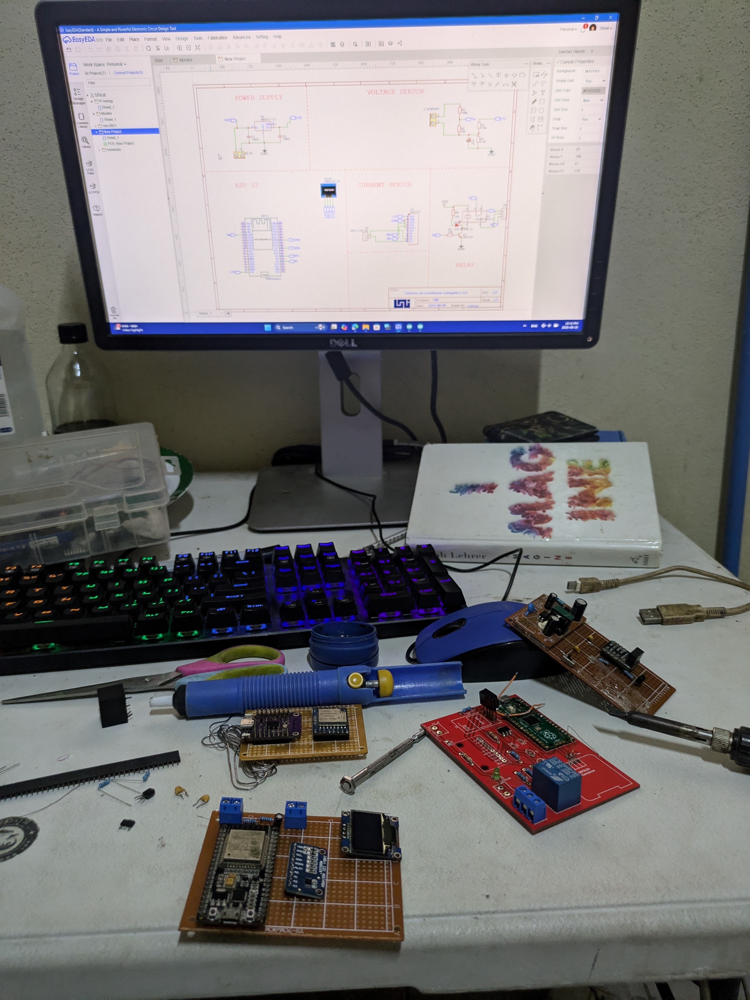

# Circuito, adaptación de señales y calibración

Este documento relaciona el [esquema completo](<../images/Schematic_Monitor_2026-10-14 (1).png>), la [adaptación del CT](<../images/Esquema CT adaptado para ESP32.png>) y el sketch `Firmware/Espower/Espower.ino`. El usuario confirmó la variante **SCT-013 de 100 A:50 mA**, una resistencia de carga **montada de 33 Ω** y la salida en **GPIO0**. Las demás magnitudes requieren medición y calibración en el equipo físico.

## Bloques y conexiones

.png>)

| Bloque | Esquema | Firmware incluido | Comprobación física |
| --- | --- | --- | --- |
| Fuente | Entrada 5 V, AMS1117-3.3, C1/C2 de 100 nF | Alimentación de la placa | Confirmar 3,3 V, polaridad, condensadores y disipación |
| Tensión | Módulo ZMPT101B, salida `V_in` | GPIO34, ADC1, `CONSTANTE_V = 234.26` | Medir el rango de salida antes de conectarlo al ADC |
| Corriente | CT SCT-013 100 A:50 mA, R8 de 33 Ω montada, polarización R5/R10 de 100 kΩ y C4 de 10 µF | GPIO35, ADC1, `CONSTANTE_I = 60.6` | Comprobar el recorte por encima de ~70,7 A ideales |
| Pantalla | OLED SSD1306 de cuatro pines | I²C SDA GPIO21, SCL GPIO22, dirección `0x3C` | Confirmar alimentación y dirección del módulo |
| Salida | Optotriac MOC3061M, triac BTA16, R6 de 220 Ω, R7 de 330 Ω | GPIO0 controla `IO` desde `led`; GPIO2 indica el estado | Comprobar estado de arranque de GPIO0 y comportamiento físico del disparo |

Los GPIO34 y GPIO35 pertenecen a ADC1 en el ESP32 clásico. El sketch configura 12 bits y atenuación de 11 dB. La atenuación no autoriza a aplicar voltajes superiores a la alimentación del chip: mide las señales en el pin antes de conectarlas y deja margen a los extremos del ADC. [Espressif documenta la configuración y las limitaciones del ADC](https://docs.espressif.com/projects/esp-idf/en/stable/esp32/api-reference/peripherals/adc/index.html).

La fotografía del montaje sirve para reconocer las placas y módulos en la mesa de trabajo. La posición de un componente en la foto no permite inferir por sí sola su valor ni verificar el aislamiento de la parte de red.



## Resistencia de carga del CT


La variante instalada es un CT de **salida de corriente 100 A:50 mA**, relación `N = 100/0,05 = 2000`. La resistencia de carga instalada es **33 Ω**. Otros SCT-013 entregan salida de voltaje y ya incorporan una resistencia de carga; a esos modelos no se les debe aplicar este cálculo ni añadir otra carga sin consultar su ficha.

Para el CT de 100 A:50 mA a 100 A RMS:

```text
Isec,rms  = 100 A / 2000             = 0,050 A
Isec,pico = 0,050 A × √2             = 0,07071 A
Vbias     = 3,3 V / 2                = 1,65 V
Vburden,pico = Isec,pico × Rburden
Rburden,máx ideal = 1,65 V / 0,07071 A ≈ 23,33 Ω
```

El punto medio procede de dos resistencias iguales de 100 kΩ. Su corriente continua es `3,3 V / (100 kΩ + 100 kΩ) = 16,5 µA`. Vistas desde el punto medio, equivalen a `100 kΩ || 100 kΩ = 50 kΩ`; con 10 µF, la constante aproximada es `τ = 0,5 s` y la frecuencia de corte es `1/(2π τ) ≈ 0,32 Hz`. El condensador estabiliza la referencia frente a la señal de 50/60 Hz.

| Carga | V RMS en la carga a 100 A | V pico | Intervalo ideal en ADC con bias de 1,65 V | Calibración teórica `N/R` |
| --- | ---: | ---: | ---: | ---: |
| 18 Ω | 0,90 V | 1,273 V | 0,377–2,923 V | 111,1 |
| 22 Ω | 1,10 V | 1,556 V | 0,094–3,206 V | 90,9 |
| **33 Ω, montado** | **1,65 V** | **2,333 V** | **−0,683–3,983 V** | **60,6** |

Con 33 Ω, el intervalo calculado excede ambos rieles del ADC: la lectura se recorta a alta corriente. En un modelo ideal de 0–3,3 V, el comienzo del recorte sería alrededor de `1,65 V / (33 Ω × √2) × 2000 ≈ 70,7 A RMS`. En la práctica puede aparecer antes por tolerancias y por el rango útil del ADC. La marca verde de la imagen de adaptación **no valida** el rango de 100 A; el mismo dibujo muestra −0,683 V y 3,983 V antes del recorte. [OpenEnergyMonitor explica el dimensionamiento de la resistencia de carga](https://docs.openenergymonitor.org/electricity-monitoring/ct-sensors/interface-with-arduino.html).

El sketch usa ahora `CONSTANTE_I = 60.6`, aproximación de `2000/33 Ω` para el montaje confirmado. Es una **constante de conversión teórica**, no una solución al recorte. Calibra contra una pinza amperimétrica de referencia **dentro del rango lineal**; para medir hasta 100 A sin recorte será necesario rediseñar la carga y recalibrar. La fórmula de EmonLib está explicada por [OpenEnergyMonitor](https://docs.openenergymonitor.org/electricity-monitoring/ctac/emonlib-calibration-theory.html).

Si se rediseña para 100 A RMS y 3,3 V, 18 Ω deja más margen que 22 Ω frente a tolerancias y al rango útil del ADC. Con 18 Ω, la disipación nominal a 100 A es `Isec²R = (0,05 A)² × 18 Ω = 0,045 W`; con los **33 Ω montados** es `0,0825 W`. El valor de potencia de la resistencia debe elegirse con margen y considerando condiciones anormales del CT. **No abras el secundario de un CT de salida de corriente mientras rodea un conductor energizado**; mantén la carga conectada y sigue las indicaciones del fabricante.

## Sensor de tensión y calibración

El ZMPT101B entrega una señal alterna acondicionada al GPIO34. El esquema representa el módulo, pero no aporta la relación real de su transformador ni los valores internos de ajuste; por ello **no se puede deducir `CONSTANTE_V = 234.26` sólo de la imagen**. Ese número es un punto de calibración del sketch.

1. Comprueba alimentación, masa común y amplitud de `V_in` con instrumentación adecuada antes de unirlo al ESP32. La entrada debe permanecer dentro del rango permitido del ADC durante todo el ciclo.
2. Aplica una tensión conocida mediante un montaje seguro y compara el `Vrms` que imprime el sketch con un instrumento true RMS de referencia.
3. Ajusta `CONSTANTE_V_nueva = CONSTANTE_V_actual × (V_referencia / V_mostrada)` y repite en más de un punto de operación.
4. Con una carga principalmente resistiva, ajusta `FASE` para que `P` se aproxime a `S` y el factor de potencia sea próximo a 1. El parámetro `FASE` de EmonLib es un **coeficiente de compensación**, no una lectura directa en grados.
5. Para corriente, usa `CONSTANTE_I_nueva = CONSTANTE_I_actual × (I_referencia / I_mostrada)` después de confirmar la carga del CT. Repite con varias cargas y revisa que no haya recorte.

Este orden y el uso de cargas de referencia siguen el [procedimiento de calibración de OpenEnergyMonitor](https://docs.openenergymonitor.org/electricity-monitoring/ctac/calibration.html). La calibración de potencia y energía depende de que **ambos canales** estén calibrados y de que el desfase se haya corregido.

## Fuente y etapa de salida

Para el AMS1117-3.3 alimentado desde 5 V, la caída nominal es `5,0 − 3,3 = 1,7 V` y la potencia térmica aproximada es `P = 1,7 V × I_carga`. Por ejemplo, a 250 mA serían `0,425 W`. La corriente real y la temperatura de la placa deben medirse; los dos condensadores de 100 nF del dibujo no bastan por sí solos para deducir estabilidad en todos los módulos y condiciones.

El resistor de 220 Ω limita la corriente de entrada del optotriac desde **GPIO0**, según el esquema. Si se **supone** una caída LED de 1,2 V, `I ≈ (3,3 − 1,2)/220 ≈ 9,5 mA`; el valor final debe comprobarse contra la hoja de datos del MOC3061M, capacidad del GPIO y tolerancias. R7 de 330 Ω pertenece a la red de disparo del triac: el dibujo no permite validar por sí solo corriente de compuerta, disipación, fusible, distancias de aislamiento o carga admisible. El firmware conmuta GPIO0 al leer `led` y refleja ese estado en GPIO2, pero el accionamiento real de la carga debe comprobarse en la placa.

GPIO0 también selecciona el modo de arranque: si queda bajo en el reset, el ESP32 entra en modo de descarga. El LED del optotriac y R6 pueden influir en ese nivel y causar estados transitorios; verifica la polarización y el arranque con la etapa de potencia aislada. [Espressif documenta GPIO0 y los pines de arranque](https://docs.espressif.com/projects/esptool/en/latest/esp32/advanced-topics/boot-mode-selection.html).

La zona conectada a red eléctrica debe construirse y verificarse por personal competente, con aislamiento, envolvente y protecciones adecuados. La documentación no sustituye una inspección de seguridad del equipo instalado.
